# Haunted Maze Mini-Jam

In the most remote corners of the countryside, a farm sits unmaintained and abandoned. Legends say there's valuable treasure to be found between the vast fields of corn, but nobody has lived to tell the tale... Will you brave the night, or die trying?

## Introduction

Welcome to the BU Game Dev Club's second Mini-Jam of Fall 2026! This game consists of a spooky maze that the player must navigate, collecting coins along the way until they can escape the maze without dying from the monsters out to get them.

In this Mini-Jam, you will:
- Learn more about Godot's Scene Tree and how Nodes are organized into a scene
- Learn about Node groups, Autoloads, and more practice with Signals
- Handle interactions between the player and various other game components (enemies, collectables, etc.)
- Implement basic collectables that the player can pick up
- Add special effects when the player takes damage, and handle what happens when the player dies
- And more! As usual, you're encouraged to experiment and browse the code that's been provided.

### Changes from Mini-Jam 1
In this Mini-Jam, you will be additionally provided this README file that contains an entire lesson plan for everything covered in meeting. You are more than welcome to go ahead of the demonstration if you want to, however you are not required to. Additionally, this lesson plan will contain additional challenges that, once you've finished everything, you're encouraged to take a crack at (or come up with your own additions! We're not judging)

## Prerequisites

In order to participate in this activity, you will need the [Godot Game Engine](https://godotengine.org/) installed on your computer.

While you are not required to have attended the last Mini-Jam, we will be building on some of the concepts we learned before. Please feel free to ask questions, and an e-board member will do their best to help you out.

### Installation Instructions

1. Download this repository as a ZIP file (recommended), or clone it locally using `git clone`. Unzip the contents somewhere on your computer.
2. Open the Godot engine.
3. Select Import, and navigate to where you downloaded this Mini-Jam, and open it.
4. That's it! You're welcome to follow along with the live demonstration, or read ahead through this doc if you'd prefer to work alone (or gain clarification)

### Resources

If you're ever confused about anything we talk about, or want to read more in-depth about how things work in Godot, check out the [Godot Online Documentation](https://docs.godotengine.org/en/latest/about/introduction.html). Additionally, hovering over a class or function in the editor will briefly explain what it does.

In addition, you're heavily encouraged to ask us questions, or interrupt the speaker if you're having troubles or would like clarification. This is not a test or a lecture: the point is to have fun and learn!

## Step 0: Project Layout

Upon opening the Godot project, you'll be presented with the main `world.tscn` scene. The root node is a basic `Node2D` that doesn't do anything (this is a common paradigm you'll see to group related nodes together). The "lock" symbol means that it is locked, i.e. it cannot be selected in the editor.

**(Reminder)**: A Scene is simply a collection of nodes in a tree-like structure, saved together to a file. They can be used to represent more complex game objects, such as players or enemies.

**(Reminder)**: A Node represents one logical building block in our game. It does one thing and one thing only, whether that be a collision shape, a sprite, a timer, etc.

The world's children are divided into two groups: `Map` and `Entities`. All of the nodes that are children of `Map` are responsible for the map in the world, and all of the children of `Entities` represent individual "entities" in our world, i.e. things we as the player can interact with (and the player itself!)

The `Map` consists of two `TileMapLayer` nodes, which render the level geometry, a `Navigation` node which is used for pathfinding, and an `AmbientLight` node that is responsible for lighting the scene. You will not need to know how these nodes work in detail, but we will be revisiting `AmbientLight` later...

As for the children of `Entities`, we have the `Player`, a simple `SquareEnemy`, the `BottomDoor`, and the `TopDoor`. The bottom/top door nodes represent the door that opens when the player wins the game. They start off closed off, but when the player wins, they open up, allowing us to escape.

### The Player

The player can move around with the `W`, `A`, `S`, and `D` keys. The camera is set up such that it simply follows the player as they move, and is forced to be restricted to the play area (via the `limit` property). Around the player is a simple circular light source that very subtly shrinks and grows. In addition, the player has a "flashlight" that lets them see around them. The flashlight is rotated such that it always faces where the user's mouse is.

### The Enemy

The enemy in our maze simply wanders around looking for the player. Every few seconds, it grabs the location of the player (defined by its `target` property) and begins to pathfind towards it. Currently, nothing happens when the player touches it, which will be our task in Step 1.

### Aside: AmbientLight

You may have noticed that this game is *very dark*. We're trying to make a horror game, after all! However, this can get rather cumbersome in development when you're trying to place nodes in the world. To bypass this, you can simply hide the `AmbientLight` node by clicking the eye icon in the scene tree on the left, which will disable lighting. Make sure to reenable this when you want to play your game with lighting!

## Step 1: Killing the Player

As of now, when the enemy touches the player, a grand total of nothing happens. Our first step will then be making the player actually take damage. This task will have two parts:

1. Checking when the enemy touches the player
2. Tracking the player's health

### Step 1.1
Let's start with #1. If we open up the SquareEnemy scene (either by clicking the icon in the scene tree, or by opening up `square_enemy.tscn`), we'll see the following:

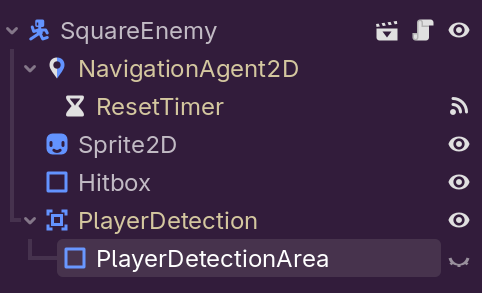

The root node is a `CharacterBody2D`, and it has a `CollisionShape2D` called `Hitbox`, which represents the collider responsible for physics. In addition, it has an `Area2D` node called `PlayerDetection`, which has another collision shape as its child. If we make that other collision shape, visible, we'll see it has a different shape to our hitbox, being a square instead of circular.

What we can do is then check if the player has overlapped with this `PlayerDetection` Area2D, which means the enemy has hit the player. We can do this using **signals**. 

**(Reminder)**: signals can be used to react to changes in the world without requiring hard dependencies between nodes. A script can connect to a signal, and do something when that signal is fired.

Select the player detection node, then on the right side of the screen, click on the "Signals" tab, and look for the `body_entered`, which is called whenever a physics body enters this `Area2D`. Select it and click "Connect," then select the root `SquareEnemy` node to be the receiver and click Connect. This will create a new function `_on_player_detection_body_entered(body: Node2D)` inside of `base_enemy.gd` (the script attached to the root node). For now, we will simply check to make sure the node was the player, and print a message to the console.

```gdscript
# in base_enemy.gd

## Called whenever another body enters our PlayerDetection Area2D
func _on_player_detection_body_entered(body: Node2D) -> void:
	if not body is Player:
		return
    print("Touched the player!")
```

If we now run our game, you'll notice that whenever the player touches the enemy, a message is printed to the console! Hurrah!

#### Aside 1: body_entered vs area_entered

`Area2D` nodes actually have two different signals for checking if a *physics body* enters (`StaticBody2D`, `CharacterBody2D`, `RigidBody2D`, etc.), and if an *area* enters (`Area2D`). The reasons for this have to do with how collisions are handled in Godot, but this just means you need to be careful with which version your using.

#### Aside 2: Yellow Nodes

You may have noticed that some of the nodes in the square enemy scene are yellow. This is because `square_enemy.tscn` is what is called an **Inherited Scene**, which means it "extends" another scene (in this case, `enemy.tscn`). This allows us to define some base scene with common nodes and functionality, then extend it to add custom logic.

### Step 1.2

Now let's make interactions actually *do* something. If we open up the player scene and view the script attached to the root node (`player.gd`), you'll see that there's already a bunch of properties already defined, such as `speed`, `starting_health`, etc. Let's create a new property called `health`, that will store the player's *current* health.

```gdscript
# in player.gd

## The amount of health the player has.
var health: int
```

**(Reminder)**: properties tagged with `@export` are visible in the editor and can be changed on the fly. This is very useful for "configurable" fields such as movement speed or starting values, but less useful for values that change constantly such as health.

You'll notice we didn't set the health to any specific value. This is because we want to set the health to the player's starting health once the player *enters the Scene Tree*. When a scene is instantiated, Godot instantiates the root note, followed by all of its children, and adds them to the "Scene Tree" (accessible by calling `get_tree()`). Once they're added, it calls `_ready()` on every node, starting from the innermost children and working its way up. So, we'll simply define a custom ready function and set the health to `starting_health` in that.

```gdscript
# in player.gd

## The amount of health the player has.
var health: int

## Called when this node enters the scene tree for the first time. Sets our health to starting_health
func _ready() -> void:
    health = starting_health
```

Having health is great, but we want to actually change it in game. While we *could* directly modify the player's health at any time, this means we lose a lot of information about what exactly is happening in regards to *why* the health is changing. Instead, we're going to create a function called `damage` that's going to handle changing the health.

```gdscript
# in player.gd

## Damages the player by some amount.
func damage(amount: int) -> void:
    health -= amount
```

Returning back to `base_enemy.gd`, we can now make the enemy damage the player.

```gdscript
# in base_enemy.gd

## Called whenever another body enters our PlayerDetection Area2D
func _on_player_detection_body_entered(body: Node2D) -> void:
	if not body is Player:
		return
    print("Touched the player!")
    # Deal 1 damage to the player
    body.damage(1) # NEW!
```

If we run our game, we'll notice... nothing seems to change? What's going on? While we are in fact changing the player's health, we're not actually doing anything if it drops to 0. Our player is immortal, uh oh! Let's fix that. In `player.gd`, navigate to your damage function and modify it as such:
```gdscript
# in player.gd

## Damages the player by some amount.
func damage(amount: int) -> void:
    health -= amount
    if health <= 0:
        print("Player is dead, oh no!") # NEW
        self.queue_free() # NEW!
```

Now if we play our game, once the player's health drops to 0, the player should be removed from the world! We did it! If you're having issues, make sure you move away from the enemy first before trying to take damage again, as the `body_entered` signal only fires when a body initially enters, rather than constantly.

### Optional Challenge 1: Better Damaging

For optional challenge 1, revisit your code in `base_enemy.gd` and modify it such that it damages the player by some variable amount. The amount of damage the enemy deals should be modifyable directly from the editor, and should be something that can be changed per enemy.

## Step 2: Visual Feedback with Tweens

We currently have a health system, which is awesome! The player is able to take so many hits before dying, and that amount is configurable via the `starting_health` property. But currently, nothing *visually* happens when we take damage. That isn't great, as our players have no idea if they've been hit or not! We're going to fix that. If we take a look at the player scene, and select its child `Sprite2D`, underneath the "CanvasItem/Visibility" category in the Inspector is a property called `modulate`. This property allows us to "tint" a sprite based on a specific color modulate value. Play around with values and see what happens to the sprite. If you're having issues seeing the changes, consider making the collision shapes hidden so you can see the sprite changing in effect.

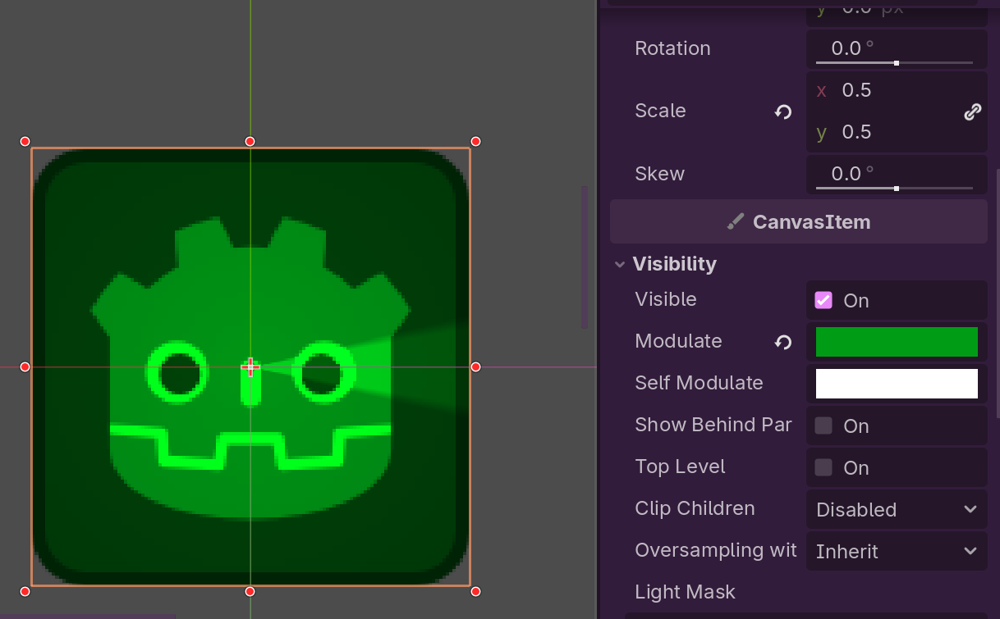

Let's now add a feature that makes the player tint red when we take damage. First, we need to add a property to specify what color the player is tinted *when* they take damage, which we will do in `player.gd` as follows:

```gdscript
# In player.gd

## The color that the player flashes when they take damage
@export var damage_color: Color #NEW
```
**Important:** Make sure this goes above all of your functions! It's recommended to keep exported properties at the top in the order you'd like them to appear in the inspector, followed by public properties (like health), then private properties (properties starting with `_`), and then finally your functions.

Once again, we're not defining a default value, and instead specifying the type, `Color`. In the inspector, we can now set the damage color for the player. Let's make it a bright red of your choosing.


#### Aside: = vs :=

You may have noticed in some places we use `=` to assign variables and `:=` in other places. The `:=` operator does what is called **type inference**. Every variable in GDScript has a type, which we can define explicitly (as we often do). However, sometimes the engine is able to cleverly determine what the type of a variable is without specifying. To do this, we simply use the `:=` operator when defining a variable. Note that this does **not** work on later assignments, and only the first time you declare a variable with the `var` keyword!

### Step 2.5: Making the Player Pulse

The problem we now have is how to we smoothly transition betwewen values? If we simply just set the `modulate` property on the sprite, it immediately becomes red, which is not what we want. The solution to this is **tweens**. Tweens are a special lightweight object designed to allow us to smoothly transition between values, which can be used for animations or special effects. We can create a new tween object by calling `get_tree().create_tween()`, then "binding" the tween to an object that its responsible for modifying with `bind_node()`. We then tween specific properties over a duration of time using `tween_property()`, and the tween will gradually change that property over until it reaches the target value. If you've ever heard of **linear interpolation**, this is a very similar concept.

```gdscript
# An example of creating a tween. We wrap in parentheses to split chained function calls on multiple lines, but this is optional.
var tween := (
    get_tree()
    .create_tween()
    .bind_node(self)
    # Sets the easing function to exponential out
    .set_trans(Tween.TRANS_EXPO)
    .set_ease(Tween.EASE_OUT)
)
# Gradually move to 0,0 over the course of a second.
tween.tween_property(self, "position", Vector2(0, 0), 1.0)
# Scale up a child node called "Sprite." These run in parallel! 
tween.tween_property($Sprite, "scale", 5.0, 0.2)
```

Easing functions allow us to control the speed of the tween over time, allowing us to make things appear to change quicker, then change slower later. You can find a list of common easing functions [here](https://easings.net/).

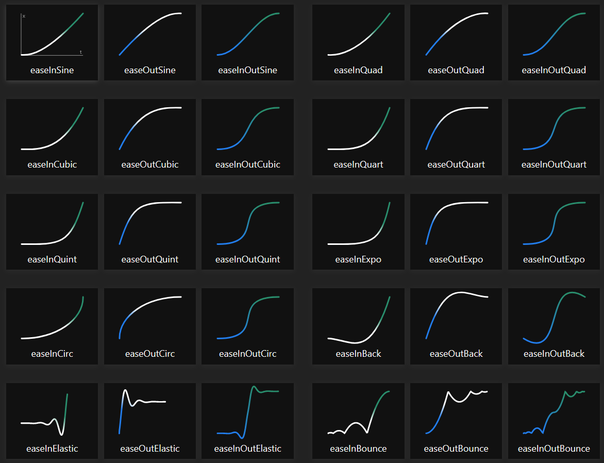

For our sprite tinting, we're going to set the color to our damage color, then create a tween that tweens *back* to our normal tint color (white). In `player.gd`, we will do the following:

```gdscript
# In player.gd

## Damages the player by some amount. 
func damage(amount: int) -> void:
	
	health -= amount
	if health <= 0:
        print("Player is dead, oh no!")
		self.queue_free()


    
#	Tints our sprite to whatever damage_color is
	sprite.self_modulate = damage_color

#	Creates a tween object. This smoothly transitions from one color to another.
	var _damage_tween := (
		get_tree()
		.create_tween()
		.bind_node(self)
		.set_trans(Tween.TRANS_QUAD)
		.set_ease(Tween.EASE_OUT)
	)
    # tween the "self_modulate" property on our sprite
	_damage_tween.tween_property(sprite, "self_modulate", Color(1, 1, 1), 1.0)
```
Feel free to play around with the transition and easing functions as you'd like until you find something you're happy with.

One final note: Godot does not like it when you have two tweens operating on the same property, and issues can arise. To get around this, instead of creating a brand new `_damage_tween` variable every time in damage, we're going to create a property called `_damage_tween`, and check if one already exists. Then, we will cancel the previous tween with `tween.kill()`.

```gdscript
# In player.gd

# Where all your properties are...

## A tween used for damage tints
var _damage_tween: Tween # NEW

# In our damage function...

if health <= 0:
    ...

if _damage_tween: # NEW
    _damage_tween.kill() # NEW

sprite.self_modulate = damage_color
_damage_tween = ( # NEW
    get_tree()
    .create_tween()
    .bind_node(self)
    .set_trans(Tween.TRANS_QUAD)
    .set_ease(Tween.EASE_OUT)
)
_damage_tween.tween_property(sprite, "self_modulate", Color(1, 1, 1), 1.0)
```
Now, let's test our game, and take damage. You should see that the player successfully flashes red when they get hit! Huzzah!

## Step 3: Picking up Coins

The point of our game is to navigate the maze and collect some coins, then once we've collected enough coins the door will open and we can escape. Currently, our maze just has our singular enemy and nothing else. Let's make some coins then! We're going to start by creating a new scene. Make sure to select `Area2D` as the root (which will become apparent soon). Rename it to `Coin`, then add a `CollisionShape2D` node and an `AnimatedSprite2D` node as children. For the collision shape, select a rectangle. Then, save your scene as `coin.tscn`. Your scene tree should look something like this:

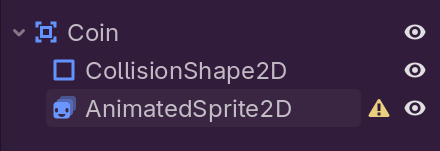

`AnimatedSprite2D` is responsible for handling, well, animated sprites. In the inspector, under Sprite Frames click on "new SpriteFrames", then click on the sprite frames value. You should see a little menu pop up at the bottom. This is called the **SpriteFrames panel**. You can open it up at any time from the options in the bottom. On the left side of the panel is a list of animations, and the right side is the frames to be used for that animation. Click on the icon that looks like a 3x3 grid that says "Add Frames from Sprite Sheet," and select `assets/coin.png` as the sprite sheet. You should see a menu that looks like this pop up:

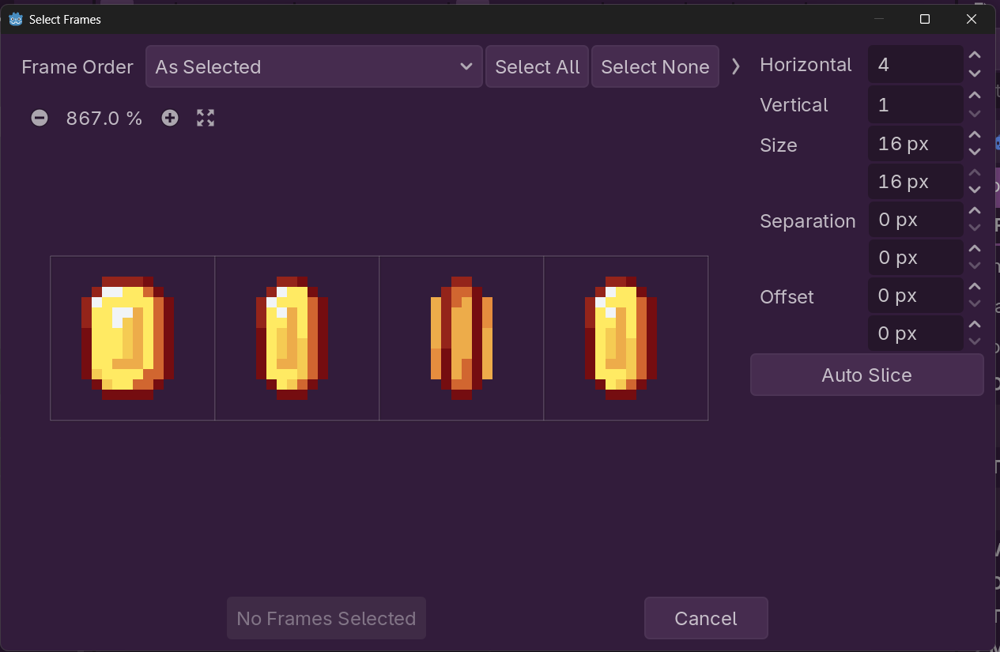

Set "Horizontal" to 4 and "Vertical" to 1 (we have 4 frames total), then click on "Select All" at the top and hit "Add 4 Frame(s)". Your SpriteFrames panel should look something like this now:

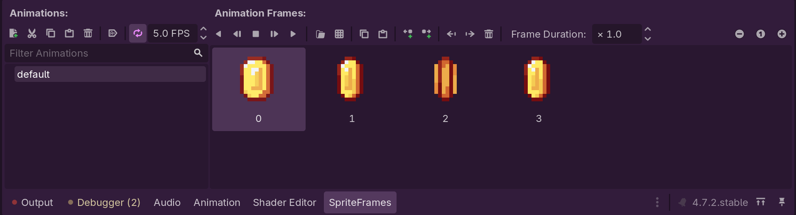

Feel free to tweak with the values here, but importantly we want to make sure **Animation Looping** is enabled, and enable **Autoplay on Load**. For the animation speed, 8 FPS is a pretty good sweet spot. Next, select `AnimatedSprite2D`, and in the Inspector under "Node2D/Transform" set the scale to 4.0. We have to do this because all of our sprites are configured to be scaled up by this same factor of 4. Finally, resize the CollisionShape2D until you have something that fits around the coin nicely. Lets go back to our world scene, and add a bunch of coins all over the map (feel free to add as little or as many as you'd like).

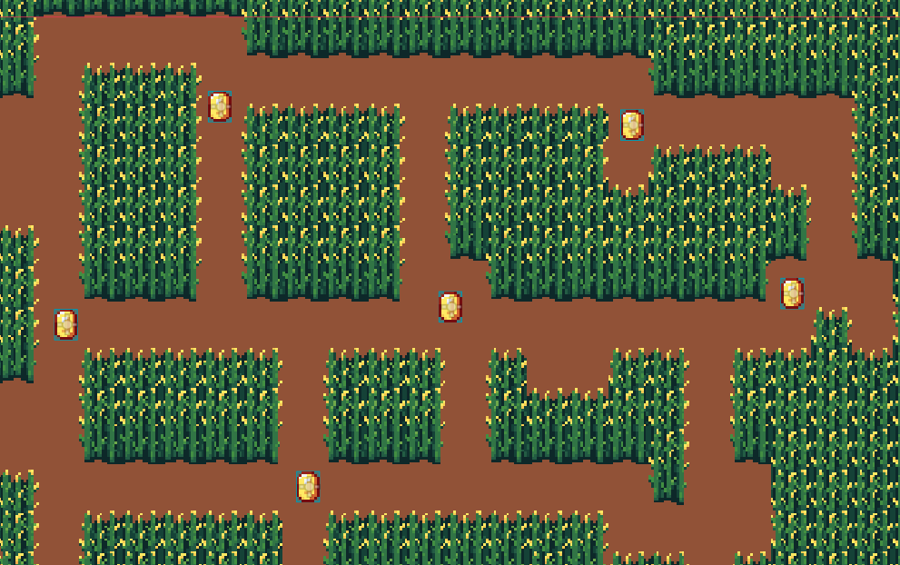

### Step 3.1: Interacting with the Player

While this is cool, our coins don't actually *do* anything. We're going to want to detect player collisions, then give the player some coins when they do interact. While we could do this similarly to how we handled enemies where we checked on the Coin's side, this can quickly become cumbersome if we add other types of collectables like items and whatnot. Because of that, we're going to approach this a little bit differently. It's encouraged to think about *why* this approach is better as we do it.

Let's return back to the player scene:

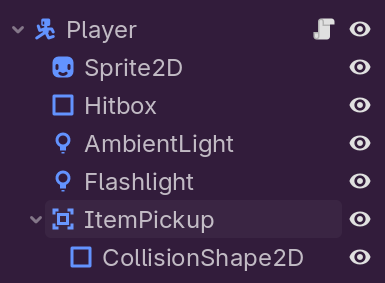

Just like the enemy scene, we have a separate `Area2D` called `ItemPickup`. It's bigger than our normal hitbox to allow the player to pick up coins from a bit farther away. Following the same process you did for connecting a signal to the root node, let's connect the `area_entered` signal from `ItemPickup` to the root player node, creating a function called `_on_item_pickup_area_entered`.

```gdscript
# In player.gd

func _on_item_pickup_area_entered(area: Area2D) -> void:
    pass
```

Before, we'd check if the area was a coin and then do something, but this is pretty non-generic and hyper specific to coins. Instead, we're going to use **Node Groups**. A Node Group allows us to define a category of related nodes, then write code targeting all nodes in a particular group. To make a new group, on the right side click on the right arrow until you see the "Groups" tab. Click on it, and click on the plus sign to add a new group. We'll call this group `collectables`. Make sure you make the group **global**, which means it exists in all scenes, not just the player. Feel free to give it a description if you'd like, but this is not required. Once you've created the group, you should see something like this:

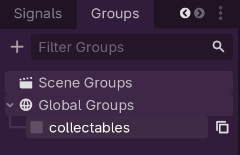


It's important that the player is *not* in this collectables group. Now, returning to `player.gd`, let's add some code to that `_on_item_pickup_area_entered` function:

```gdscript
# In player.gd

func _on_item_pickup_area_entered(area: Area2D) -> void:
    if area in get_tree().get_nodes_in_group("collectables"): # NEW
		area.handle_collect(self) # NEW
```

This function checks if the `Area2D` node is in the `collectables` group, and, if it is, calls `handle_collect`. But handle_collect doesn't exist yet! We'll need to define it for our coin. Returning to the coin scene, attach a new script to the root `Area2D` and call it `coin.gd`. Then, define a function called `handle_collect` that takes in a player:

```gdscript
# In coin.gd

## Handles what to do when this coin is collected by the player.
func handle_collect(player: Player) -> void:
    print("Coin collected!")
    self.queue_free()
```

Currently, we're just printint to the console, but this is a good place to stop to test. Now, make sure to add the coin to the `collectables` group in the groups tab, then run your game. When the player walks over a coin, you should see this message printed in the console, and it disappear.

#### Aside: Duck Typing

Despite having type annotations, Godot is a "dynamically typed" language. This means that the engine doesn't actually care about types at all until runtime, and will assume everything is A-OK until then. This enables a feature commonly referred to as "duck typing," where you can call some arbitrary function on an object regardless of what it actually does or look like, and the language will call it accordingly (if it walks like a duck and quacks like a duck, it is a duck). Python is another example of a language with duck typing.

### Step 3.2: Tracking Collected Coins

Let's make collecting coins actually do something. Just like we did for health, we're going to create a field in the player called `coins`, which will track how many coins we've collected so far. Then, we'll simply increment this value when we collect a coin. Simple!

```gdscript
# in player.gd

## The number of coins the player currently has.
var coins := 0 # NEW


# in coin.gd

## Handles what to do when this coin is collected by the player.
func handle_collect(player: Player) -> void:
	print("Coin collected")
	player.num_coins += 1 # NEW
	self.queue_free()

```

Very simple stuff! Hopefully this feels simple, at least. 

### Step 3.3: Visual Feedback and Autoload

Collecting a coin now works, but nothing much happens visually when we do. Let's make things a little more interesting in that regard. Navigate to the world scene and select the `AmbientLight` node. You might notice there's a button called "Do Lightning." When you click on it, you should see the world briefly flashes white!

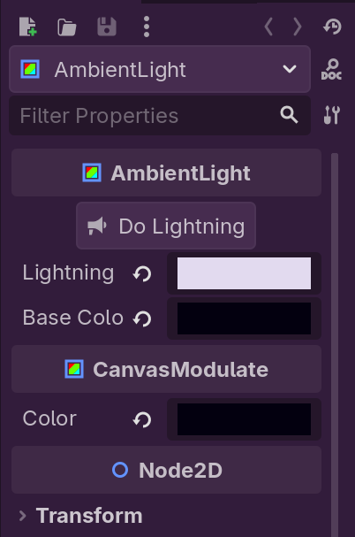

What's going on here? If we go to the AmbientLight's attached script, you'll see a function called `do_lightning()`. It uses tweens to gradually change the color of the lightning from a blackish-blue to a bright white and back to blackish-blue. Feel free to tweak this if you'd like, but it's totally optional. 

We want to make the coins call this `do_lightning()` function when they're collected. One way you might think of doing it is by using a function called `get_node()`, which gets a node relative to the current node in the scene tree. While this *works*, it's susceptible to bugs, as it relies on the structure of the scene tree matching the bath provided.

```gdscript
# One way to grab AmbientLight. Not the best method...
var ambient_light := get_node("../Map/AmbientLight")
```

One interesting thing about `AmbientLight` is that there will only ever be *one* in a scene. This is because it's a `CanvasModulate` node, which modifies the scene color to allow for 2D lighting, and we can't modulate the color two times. This means we can use a programming pattern called a **Singleton** for this. Let's go to Project -> Project Settings -> Globals. Here, you'll see a tab called "Autoload." 

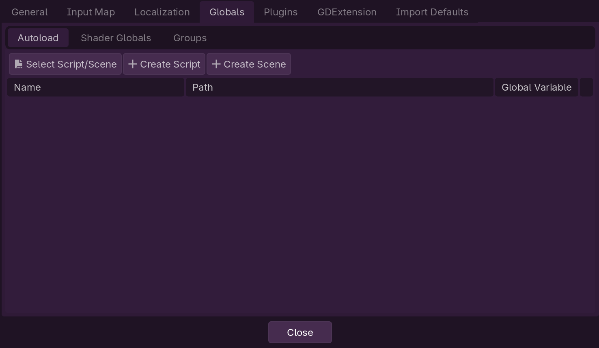

Autoloads are nodes/scenes that are automatically loaded immediately when the game starts, regardless of the current scene. This is useful for "manager"-like nodes that there will only *ever* be one instance of. We're going to add one to manage all of the **lighting** in the scene (pay attention to spelling: lighting vs lightning). Click create script, and make a new script called `lighting_manager.gd`.

**Important**: you *cannot* give autoloads a class name. This is because autoload names are added to the global namespace, and are based on the "Name" field in Globals.

Let's add a function in here called `do_lightning`. This function will be responsible for calling the `AmbientLight`'s `do_lightning` function for us, so oother classes don't need to know anything about how to access said `AmbientLight`. 

```gdscript
# in lighting_manager.gd

## Attempts to do a lightning effect if possible
func do_lightning() -> void:
    pass
```

Except, how do we reference the node in the first place? `get_node()` is not a good method because our scene may or may not even *have* an `AmbientLight` node, nor may it be in the place we expect. Instead, we're going to create a variable called `ambient_light` that stores the node to use. Finally, in `ambient_light.gd`, we'll set said variable to the correct node.

```gdscript
# in lighting_manager.gd

var ambient_light: AmbientLight # NEW


# in ambient_light.gd

## Called when this node enters the scene tree for the first time. 
## Sets our color to base color
func _ready() -> void:
	color = base_color
    LightingManager.ambient_light = self # NEW
```

One final thing: if you hit "reload saved scene," you may notice that you get an error saying `LightingManager` doesn't exist. This is because `ambient_light.gd` is what is called a **tool script.** Tool scripts are annotated with `@tool` at the top, which tells Godot to run the script in the editor in addition to running it in game. Our Lighting manager is *not* a tool script, so it hasn't been loaded. To fix this, we'll add a check to make sure we're runnning in-game and not in the editor:

```gdscript
# in ambient_light.gd

## Called when this node enters the scene tree for the first time. 
## Sets our color to base color
func _ready() -> void:
	color = base_color
    if not Engine.is_editor_hint(): # NEW
        LightingManager.ambient_light = self
```
Now, reloading the scene will no longer cause an error. Yippee! Now, we can actually call `do_lightning` in `lighting_manager.gd`, and use said function in `coin.gd`.

```gdscript
# in lighting_manager.gd

## Attempts to do a lightning effect if possible
func do_lightning() -> void:
	# does nothing if ambient_light is null
	if ambient_light:
		ambient_light.do_lightning()

# in coin.gd


## Handles what to do when this coin is collected by the player.
func handle_collect(player: Player) -> void:
    print("Coin collected!")
    LightingManager.do_lightning() # NEW
    self.queue_free()
```

Now, if we pick up a coin, we'll see a flash of lightning! Hurrah!

#### Aside: Autoloads and Singletons

Singletons are what is commonly referred to as an "anti-pattern" in the Object-Oriented Programming world. This is because they place an extremely hard "one of" restriction, and makes your code more tightly coupled. For example, if we had a `PlayerManager` singleton, and all of a sudden added a second player, we have to rewrite how this manager works entirely, or remove it and make it not a singleton. This doesn't mean you should *never* use singletons, but simply just be careful with your use of them.

### Optional Challenge 2: Better Coin Effects

Modify your `handle_collect` function in `coin.gd` to make it so the coin has a "pickup" animation, i.e. it moves upwards and fades out. To prevent the player from interacting with the coin in this state, you can use the fact that `CollisionShape2D` nodes have a `disabled` property, which prevents them from being active.

### Optional Challenge 3: Heart Pickup

Add a new collectable called a "Heart" that, when the player picks it up, heals the player by some amount of health. The collectable should use your existing framework for collectables, and use the `collectables` group and a `handle_collect` function.

## Step 4: Winning the Game

We're at the home stretch! We have coins and enemies, so now we just need to make the player actually win. Returning to `world.tscn`, browse to the `TopDoor` and `BottomDoor` nodes. These nodes represent the gate that opens up when we're supposed to win. We're going to make it so when the player picks up a certain amount of coins, the gates open up, allowing us to escape. If we click on the doors, we can see a boolean called `open`. Clicking on this makes the doors swing open. Let's write some code to automatically toggle this flag when we click enough coins.

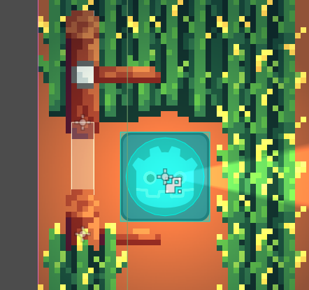

### Step 4.1: Telling the Doors to Open

Let's go to `player.gd`. You'll notice there's a variable called `coins_to_win`, which represents how many coins we need to pick up to win. We want to write our code such that if `coins` is greater than `coins_to_win`, we win! So, how do we check this without updating how `coin.gd` updates the coin value? The answer is **setters**.

All properties in godot can have a custom getter/setter defined for them. These special functions run when the property itself is modified, meaning users can just normally reassign the variable without worrying about calling the right `set()` method. Modify the coins property as so:

```gdscript
# in player.gd

## The number of coins the player currently has.
var coins := 0: # Note the : after the 0
    set(value): # NEW
        coins = value # NEW
        if coins >= coins_to_win: # NEW
            # TODO
```
This set function handles setting the *actual* coins value to this new value, which means we can inject our custom handling in regards to checking if we've won. But how do we tell the doors we've won? Normally we'd use a signal, but there's no signal for this specific thing. If only there was some way we can define custom signals...

```gdscript
# in player.gd

## A signal that's fired when the player's win condition is met.
signal win_condition_met # NEW


# Where your properties are defined

## The number of coins the player currently has.
var coins := 0:
    set(value):
        coins = value 
        if coins >= coins_to_win:
            win_condition_met.emit() # NEW
```

Huh, that was simple. Perfect! Now, we can connect this win condition met signal to each of our doors. Make sure you connect it to *both* doors, and use the same handler function in `end_door.gd`, which will by default be `_on_player_win_condition_met`. We'll be moving faster because hopefully this is all familiar to you.

```gdscript
# in end_door.gd

## Called when the player's "win condition" signal is fired, and opens the door.
func _on_player_win_condition_met():
	open = true
```
Now, if we play our game and collect the number of coins we need, the doors open! Yippee! Except, nothing else happens when we walk out the door. Let's change that.

### Optional Challenge 4: Better Death Checking

Using what we now know about custom setters, modify your code that checks if the player is dead to do the `health <= 0` check in a custom setter, rather than in `damage`.

### Step 4.2: Winning the Game

let's make a new `Area2D` Node in the `Entities` section called `WinArea`. Give it a `CollisionShape2D` with a rectangle as the shape, and position it right by the end gate like so:

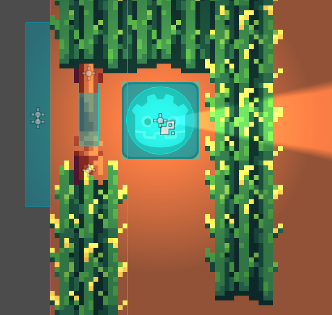

Let's give it a new script called `win_area.gd`. Then, we'll connect the `WinArea`'s `body_entered` signal to itself, which should create a new `_on_body_entered` function. Once this function is called, we'll simply check if the player entered, then close the game!

```gdscript
# in win_area.gd

## Called when a Physics body enters this Area2D. 
## We're checking if it's the player, and if it is, we win the game!!!
func _on_body_entered(body: Node2D) -> void:
	if body is Player:
		print("YOU WIN!!!")
		get_tree().quit()
```

If we play our game, and get enough coins (or just manually open the door), we'll notice... nothing happened? Why is that? This has to do with **collision layers**.

If we carefully inspect the player node, you'll notice in the `CollisionObject2D` section there's a section called `Collision`. On the layer section, we have layer 2 selected, instead of section 1. Why is that? The answer is the *enemy*. The enemy *also* has a hitbox, and yet when we interact with the enemy, we don't collide with them. The way we achieved this is by putting the collision entities on layer 2, but make them *scan* layer 1. This means they check for objects on layer 1 to collide with (the terrain is on collision layer 1), but things will only collide with them if they're scanning layer 2. This lets our entities collide with walls, but not each other.

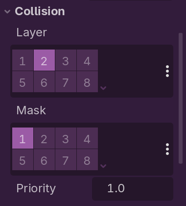

Remember: collision objects exist on **collision layers**, and check for objects to collide with on **mask layers**.

Using this knowledge, let's modify our `WinArea` area to use mask layer 2. Now, when we play our game, we actually end the game! Yippee!

## Continuing From Here

If you've reached this point, congrats! You've successfully implemented everything for this Mini-Jam! Be proud of yourself :D

Now's the time to ask questions, review what your node, and play around! Feel free to approach the optional challenges we described, or come up with your own changes! Here's a list of ideas:

- Add a proper death animation to the player, so they don't just disappear on death
- Add more enemy types that can interact with the player. Take a look at `base_enemy.tscn` if you want a good starting point for how the original enemy was designed
- Allow for variable strength lightning. Currently lightning is pretty bright already, but can you figure out a way to make different "strengths" of flashes?
- When the player is hit, knock them around a bit rather than *just* make them flash. This might make things feel better, or worse! The point is to experiment. 